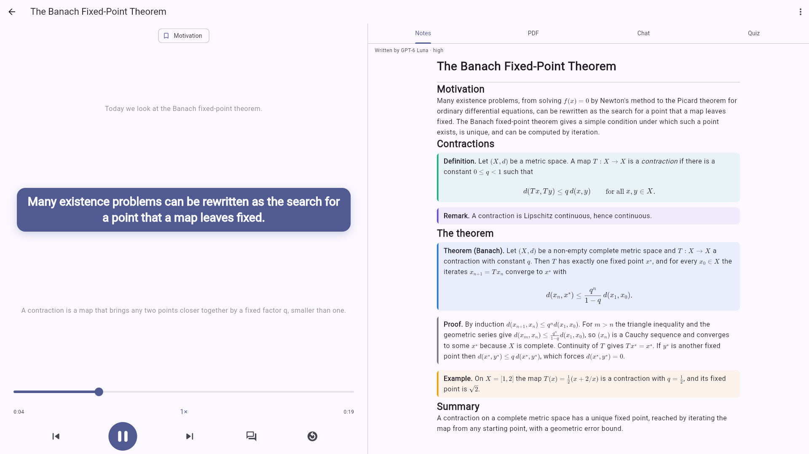

# LearnMath

[](LICENSE)

**Your personal math lecturer.** Describe a topic, and LearnMath writes
graduate-level lecture notes with an AI model, checks their computations, and
reads them to you as a spoken lecture with synced subtitles. Plan whole
courses, ask a tutor about any passage, quiz yourself, and review with
flashcards. It runs on Android and in desktop browsers.

- **Try it in your browser:** [gabirodz.github.io/learnmath](https://gabirodz.github.io/learnmath/)
- **Android:** download the APK from [Releases](https://github.com/Gabirodz/learnmath/releases/latest)



## Features

**Lessons and courses**
- Ask for a single lesson ("the spectral theorem, with proof") or a whole
  course; the course outline is planned first, and its lessons are written one
  by one or all at once.
- Continue a course with a part 2, 3, ..., planned from what the earlier parts
  covered.
- Before a lesson is written, see what it builds on and create the missing
  prerequisites too.
- Import your own PDF books: chapters become lessons, read into notes, with a
  chat that cites pages and an optional lecture.

**Listening**
- Every lesson becomes a spoken lecture written for the ear, with subtitles
  that show the formulas as LaTeX and pauses to think after key statements.
- A mini-player, playback speed, auto-play into the next lesson of a
  course, and lock-screen and headset controls on Android.
- "Explain this again differently" re-explains the current point in other
  words, then resumes.

**Notes**
- Markdown and LaTeX notes with definitions, theorems, proofs and examples in
  colour-coded boxes, and a PDF export.
- Computations in the notes are re-run with SymPy on your phone; failures are
  repaired once automatically.
- Optional proof review: a second model from another family referees the
  proofs, and real issues are fixed.

**Studying**
- A tutor chat grounded in each lesson's notes; long-press a passage to ask
  about it.
- Quizzes (multiple choice or free answer, three difficulties), graded
  against the notes.
- Exercises with hints and solutions on demand.
- Lectures end with a few questions to answer from memory, and a short review
  lecture arrives three days after you finish one.
- Reviews of several studied lessons, with flashcards that come back at
  growing intervals.

**Your choice of models and voices**
- Pick the model and reasoning effort for each lesson; the Batch API presets
  cost about half as much and usually answer within minutes.
- No API key? Copy a prompt to your own ChatGPT, Claude or Gemini and paste
  the answer back; the lesson is then checked and recorded on the device.
- Voices run on the device (Kokoro, Kitten, Piper) after a one-time
  download, or come from an OpenRouter speech model.

## What you need

- **An [OpenRouter](https://openrouter.ai/keys) API key** for writing lessons,
  the chat and quizzes. You pay OpenRouter for what you use; the app itself
  is free. Without a key you can still use the "your own AI assistant" route
  above.
- **Space for a voice:** the on-device voices are downloaded once (31 to
  103 MB on Android; 90 to 330 MB in the browser).

## Install

**Android.** Download the latest APK from
[Releases](https://github.com/Gabirodz/learnmath/releases/latest) and open it;
Android asks you to allow installing apps from your browser or file manager.
To update, install a newer APK over the old one: your lessons are kept.

**Browser.** Open [gabirodz.github.io/learnmath](https://gabirodz.github.io/learnmath/)
on a laptop or desktop computer. Chrome or Edge work best: they run the voice
on the graphics card (WebGPU), which is much faster. Your lessons are stored
in that browser.

The browser version does not yet have the SymPy checks, PDF book import, the
notes PDF, backups or notifications, and it records lectures only while the
tab is open.

## Privacy

LearnMath has no accounts, no server of its own, and no analytics. Your
lessons, chats and progress stay on your device (or in your browser). The app
talks to:

- **OpenRouter**, with your own key, to write lessons and answer questions,
  and to Mathpix if you choose it for reading book pages;
- **GitHub and Hugging Face**, to download a voice model the first time;
- **jsDelivr**, to download the Python runtime for the SymPy checks (Android)
  and the voice engine (browser);
- **Google's servers**, from which the browser version loads Flutter's
  drawing engine and fonts.

Your API key is stored only on your device.

## Build from source

You need [Flutter](https://docs.flutter.dev/get-started/install) (stable
channel; developed with 3.50) and, for Android, the Android SDK.

```sh
flutter pub get
flutter run                                  # on a connected device
flutter build apk --release                  # Android APK
flutter build web --release --no-wasm-dry-run
python3 tool/serve_web.py                    # serves build/web at http://127.0.0.1:8790/
```

Run the checks with:

```sh
flutter analyze
flutter test --exclude-tags live             # tests that call OpenRouter need OPENROUTER_API_KEY
```

The tests need `clang` on the `PATH` (a native build hook of the PDF package).
[docs/DESIGN.md](docs/DESIGN.md) explains how the app works inside: the
generation pipeline, the batch queue, the voices, the web version and the
code layout.

## Status

LearnMath works on Android and in desktop browsers, and is in active
development. Things still to do:

- Bring the SymPy checks, book import, notes PDF and backups to the browser
  version.
- Compress recordings (lectures are stored as WAV, about 3 MB a minute).
- Publish on F-Droid and Google Play.

## Licence

Copyright (C) 2026 Axel Gabriel Rodriguez Zarate.

LearnMath is free software: you can redistribute it and/or modify it under
the terms of the GNU General Public License as published by the Free Software
Foundation, either version 3 of the License, or (at your option) any later
version. It is distributed in the hope that it will be useful, but WITHOUT ANY
WARRANTY; without even the implied warranty of MERCHANTABILITY or FITNESS FOR
A PARTICULAR PURPOSE. See [LICENSE](LICENSE) for the full text.

The voice engine contains eSpeak NG, which is under the GPL.
[THIRD_PARTY_NOTICES.md](THIRD_PARTY_NOTICES.md) lists it and the other
components the app is built from or downloads, and the app shows the licences
of its packages under Settings, About, "Open-source licences".

## Support

LearnMath is free. If it is useful to you, you can
[buy me a coffee](https://buymeacoffee.com/gabirodz). The same link is in the
app under Settings, About; nothing in the app depends on it.
